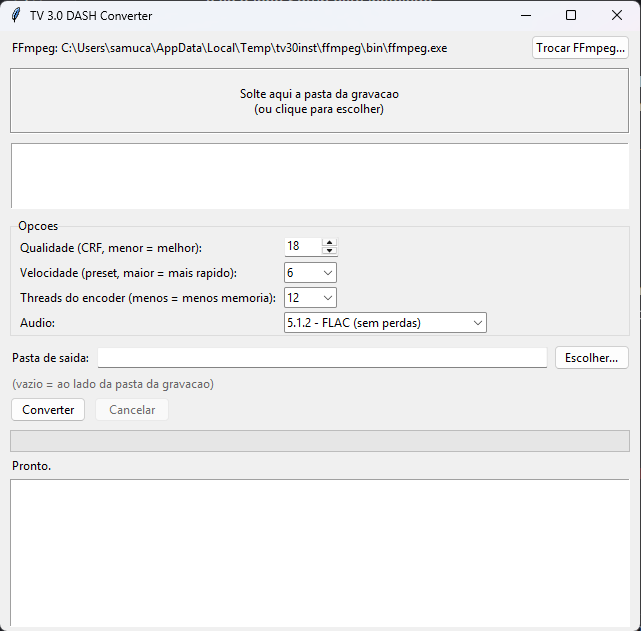

# TV 3.0 DASH Converter

Conversor com interface grafica (Windows) para gravacoes DASH de TV 3.0 brasileira:
video **LCEVC sobre VVC/H.266 em 4K HDR10** + audio **MPEG-H 3D Audio**.
Arraste uma ou mais pastas de gravacao para a janela e pronto: elas entram numa **fila**;
o programa junta os segmentos, descarta duplicados, corrige sobreposicoes/lacunas da
linha do tempo e converte para **4K 10 bits HDR10** em AV1, HEVC ou H.264, nos
conteineres MKV, MP4, MOV ou WebM.



## O que ele resolve

Gravacoes feitas de broadcast ISDB-Tb (TV 3.0) chegam como pastas de segmentos
DASH (`local_000.mpd`, `v1_1-*.m4s`, `v1_2-*.m4s`, `a2_3-*.m4s`, init em `*-init.mp4`),
muitas vezes divididas em varias pastas ("parte 1", "parte 2"...) com segmentos
duplicados na emenda. Este programa:

- **Inventario de segmentos** nas subpastas, escolhendo a copia maior em duplicatas;
- **Analisa a linha do tempo** (tfdt/trun de cada `moof`) e regenera o `SegmentTimeline`
  exato, eliminando as **sobreposicoes e lacunas** que causam "pulos" e audio repetido;
- **Monta um MPD estatico** com as duas camadas de video (base VVC 1080p +Enhancement
  LCEVC 4K, `dependencyId`) que o FFmpeg entende, e um `audio.mp4` concatenado;
- **Descarta o audio anterior ao inicio do video** (os segmentos de audio que
  sobram quando a gravacao comeca no meio de um segmento de video), e realinha
  o inicio do audio ao do video com `-itsoffset`, preservando a defasagem
  original entre as trilhas;
- **Alinha o inicio do audio ao do video** (`-itsoffset`) para nao haver atraso;
- Le os metadados **HDR10** (mastering display + MaxCLL/MaxFALL) do primeiro frame
  e reaplica no encoder;
- Codifica o video 4K decodificado com o filtro `lcevc` em **AV1 (SVT-AV1)**,
  **HEVC (x265)** ou **H.264 (x264)**, sempre com os metadados HDR10, e o audio MPEG-H com
  o decoder oficial da Fraunhofer (`libmpeghdec`) para FLAC, PCM 24 bits, AAC, Opus,
  AC3, E-AC3 ou MP3, em 5.1.2 / 5.1 / estereo (conforme o que o codec e o conteiner aceitam).

## Fila, codecs e conteineres

- **Fila**: cada pasta solta (ou escolhida) vira um item com as opcoes vigentes no momento
  em que foi adicionada. Da para reordenar, remover, limpar concluidos e reaplicar as opcoes
  aos itens selecionados. "Cancelar atual" pula o item; "Parar fila" interrompe tudo.
- **Conteineres**: MKV (aceita tudo), MP4, MOV (HEVC/H.264) e WebM (so AV1 + Opus). A
  interface so mostra as combinacoes de video/audio que o conteiner aceita.
- **H.264** nao tem HDR10 padronizado: o programa grava os metadados, mas a maioria dos
  players mostra as cores lavadas. Prefira AV1 ou HEVC.
- Os problemas de execucao sao gravados em `%LOCALAPPDATA%\TV30Converter\crash.log`.

## Instalador (recomendado)

O instalador `TV30Converter-Setup-1.2.0.exe` ja leva **tudo dentro**: o app, o FFmpeg
com MPEG-H + LCEVC + SVT-AV1 e as DLLs necessarias (nao precisa de Python, MSYS2 nem
de configurar nada). Instala por usuario (sem admin), cria atalhos e desinstalador.

Como o FFmpeg usa o decoder MPEG-H da Fraunhofer (nonfree), o instalador **nao e
publicado** no GitHub: voce o gera na sua maquina (veja "Gerar o instalador").

## Requisitos

- Windows 10/11 x64, CPU com AVX2.
- **FFmpeg com `libmpeghdec`, `lcevc` e `libsvtav1`**. O programa procura na ordem:
  1. o caminho escolhido no botao "Trocar FFmpeg...";
  2. `ffmpeg\bin\ffmpeg.exe` junto ao programa;
  3. `C:\ffmpeg-mpegh\bin\ffmpeg.exe` (padrao do script de build deste repo);
  4. `ffmpeg` no PATH.
  O FFmpeg comum (gyan.dev etc.) **nao serve**: nao decodifica MPEG-H audio.
- Python 3.10+ somente se quiser rodar de codigo (`pip` nao e necessario: so stdlib).

## Como gerar o FFmpeg (uma vez)

Instale o [MSYS2](https://www.msys2.org/) e, no terminal **MSYS2 UCRT64**:

```bash
git clone https://github.com/Samuelzin-jgs/tv30-dash-converter.git
cd tv30-dash-converter
bash tools/build-ffmpeg-mpegh.sh
```

O build usa `mpeghdec` (Fraunhofer) e `LCEVCdec` (V-NOVA) por ligacao estatica.
Como o `mpeghdec` tem licenca **nonfree**, o `ffmpeg.exe` resultante e para
**uso pessoal** e **nao pode ser redistribuido** (nem neste repositorio).

## Gerar o instalador

Com o FFmpeg ja compilado (secao acima) e o [Inno Setup 6](https://jrsoftware.org/isinfo.php)
(`winget install JRSoftware.InnoSetup`):

```bat
build-installer.bat
```

Isso seleciona so as DLLs realmente usadas pelo FFmpeg (`tools/make_payload.py`, ~117 MB),
empacota o app com PyInstaller e compila `installer/setup.iss`. Resultado:
`release\TV30Converter-Setup-1.2.0.exe` (~36 MB).

## Como usar

1. Abra pelo atalho do instalador (ou, de codigo: `python app.py` / `Converter.bat`).
2. Arraste a pasta raiz da gravacao (ex.: `captura-f1-gp-sp-qualy`) para a janela
   (varias de uma vez tambem vale). Cada gravacao encontrada entra na fila.
3. Escolha conteiner, codecs, CRF/preset, o **limite de memoria** (so AV1) e a pasta de saida
   (padrao: junto a gravacao). Muda as opcoes e solta outra pasta para ter configuracoes
   diferentes na mesma fila.
   O limite e aplicado de verdade ao ffmpeg (Job Object do Windows): se a conversao estourar,
   ela para com uma mensagem clara. Menos memoria = mais lento (o encoder usa menos threads).
4. Clique em **Iniciar fila**. A preparacao e rapida (usa hardlinks, so copia o audio);
   a codificacao 4K e lenta (independente de GPU, ~0,3x no preset 9 com 12 threads).

O stage (`_tv30_stage`) e removido ao final de cada item; so o arquivo final fica no disco.

## Limitacoes

- Presets 10+ do SVT e "8K" sao do dominio do FFmpeg/SVT, sem ajuste aqui.
- Se o ffprobe reportar mais de uma faixa de audio, e usada a primeira.
- Nao ha suporte a legendas nem a multiplos periodos DASH.

## Estrutura

```
app.py                    Interface (Tkinter + drag-and-drop nativo do Windows)
dashconv.py               DASH inventory/timeline/staging/encoding (sem dependencias)
tools/build-ffmpeg-mpegh.sh  Build do FFmpeg com MPEG-H + LCEVC no MSYS2
tools/make_payload.py     Seleciona as DLLs necessarias do FFmpeg para o instalador
installer/setup.iss       Script do Inno Setup (PT-BR/EN, icone, atalhos, desinstalador)
build-installer.bat       Gera o instalador completo
```

## Licenca

Codigo: MIT (veja LICENSE). O ffmpeg.exe compilado por `tools/build-ffmpeg-mpegh.sh`
e regido pelas licencas dos componentes (Fraunhofer MPEG-H e nonfree) e deve ser
recompilado por cada usuario.
